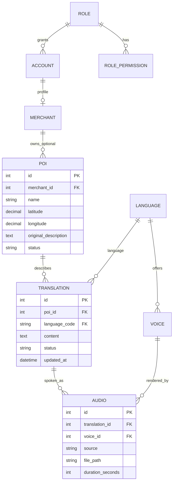
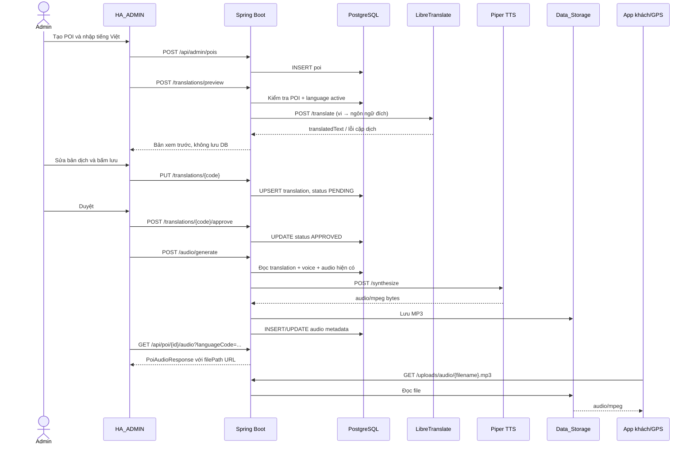

# Báo cáo kỹ thuật HA_App và HA_ADMIN

> Tài liệu onboarding dựa trên source tree, `version_1.0.sql`, cấu hình Spring/Docker, tài liệu API, test source và kết quả chạy đã ghi nhận ngày 12-10-2026. Báo cáo này mô tả trạng thái đã khảo sát; `PASS` chỉ dùng cho lệnh hoặc luồng có kết quả thực tế. Các ví dụ request/response được ghi rõ là ví dụ minh họa, không thay thế bằng chứng runtime.

## Mục lục

1. [Tổng quan](#1-tổng-quan-dự-án)
2. [Cấu trúc thư mục và điểm bắt đầu sửa code](#2-cấu-trúc-thư-mục-và-các-file-quan-trọng)
3. [Kiến trúc frontend](#3-kiến-trúc-frontend-ha_admin)
4. [Kiến trúc backend](#4-kiến-trúc-backend-ha_app)
5. [Database và quan hệ dữ liệu](#5-database-và-quan-hệ-dữ-liệu)
6. [Quy trình POI → text → translation → audio](#6-luồng-nghiệp-vụ-poi-text-translation-audio)
7. [Phân quyền và bảo mật](#7-phân-quyền-và-bảo-mật)
8. [Docker và môi trường chạy](#8-docker-và-môi-trường-chạy)
9. [API và hướng dẫn sử dụng](#9-api-và-hướng-dẫn-sử-dụng)
10. [Kiểm thử và chẩn đoán](#10-kiểm-thử-và-chẩn-đoán-lỗi)
11. [Lịch sử triển khai và file thay đổi](#11-lịch-sử-triển-khai-và-file-thay-đổi)
12. [Checklist vận hành thành viên mới](#12-hướng-dẫn-vận-hành-cho-thành-viên-mới)
13. [Vấn đề còn tồn đọng](#13-các-vấn-đề-còn-tồn-đọng-và-kế-hoạch-tiếp-theo)
14. [Kết luận](#14-kết-luận)

---

## 1. Tổng quan dự án

### Giải thích

Hệ thống là nền tảng hướng dẫn tham quan Hội An theo POI (*Point of Interest*, điểm tham quan). Quản trị viên tạo điểm có tọa độ và bán kính kích hoạt, nhập nội dung thuyết minh tiếng Việt, yêu cầu máy dịch tạo bản nháp, biên tập/duyệt từng ngôn ngữ, rồi tạo giọng đọc MP3. Ứng dụng khách lấy POI hoạt động và audio theo ngôn ngữ; metadata audio nối nội dung dịch với voice.

- `HA_ADMIN/` là giao diện quản trị React + TypeScript + Vite. Nó xử lý form, trạng thái giao diện, gửi request và phát audio thử.
- `HA_App/` là backend Spring Boot và cấu hình Docker. Backend xác thực JWT, kiểm tra role, xử lý nghiệp vụ, truy cập PostgreSQL, gọi LibreTranslate/Piper và phục vụ file audio.
- PostgreSQL lưu POI, language, translation, voice, audio, account và role. Redis được khai báo trong Compose và cấu hình ứng dụng; trong các luồng POI/text/audio được khảo sát, chưa thấy truy vấn Redis trực tiếp.

### Sơ đồ kiến trúc

```mermaid
flowchart LR
  Admin[Quản trị viên] -->|trình duyệt| FE[HA_ADMIN React/Vite]
  FE -->|HTTP JSON + Bearer JWT| API[HA_App Spring Boot :8080]
  API -->|JPA và JdbcTemplate| DB[(PostgreSQL)]
  API -->|cache/session config hiện có| Redis[(Redis)]
  API -->|POST /translate| LT[LibreTranslate]
  API -->|POST /synthesize| Piper[Piper TTS + FFmpeg]
  API -->|ghi file| Store[(Data_Storage host)]
  Store -. mount /app/uploads/audio .-> API
  Guest[Ứng dụng khách / GPS] -->|GET /api/poi/locations| API
  Guest -->|GET /api/poi/{id}/audio| API
  Guest -->|GET /uploads/audio/...| Store
```

### Cách hoạt động

Trình duyệt FE chạy trên host thường gọi `http://localhost:9999`, là cổng host được map vào backend container `8080`. Backend giao tiếp với các service trong Docker qua DNS service name (`postgres`, `redis`, `libretranslate`, `piper-tts`), không qua `localhost`. Audio là file trên host `HA_App/Data_Storage/`; mount volume khiến cùng file nhìn thấy từ container tại `/app/uploads/audio`, còn DB lưu URL public `/uploads/audio/<filename>.mp3`.

Ví dụ minh họa: quản trị viên tạo POI “Chùa Cầu” với tọa độ, nhập phần giới thiệu tiếng Việt, preview tiếng Anh/Nhật/Hàn/Trung, sửa bản dịch tiếng Anh, lưu trạng thái chờ duyệt, bấm duyệt, tạo audio. Khách chọn English; ứng dụng gọi API audio cho POI đó, nhận URL, tải MP3 và phát. Tọa độ/radius phục vụ danh sách POI cho tính năng địa điểm; logic định vị tự động phía ứng dụng khách không được kiểm thử trong phiên tài liệu này.

### Trạng thái tính năng

- **Có code và có bằng chứng runtime**: API login và `/me`, CRUD POI, preview dịch năm mã ngôn ngữ, lưu/duyệt nội dung, tạo MP3 Piper cho các trường hợp đã chạy, file MP3 qua URL static và hợp đồng API audio cũ.
- **Có code, một phần test tự động**: trạngi thái giao diện FE, quản lý POI/audio, xử lý lỗi media; test tự động frontend/E2E trình duyệt chưa có trong scripts hiện tại.
- **Chưa xác nhận end-to-end**: phát thành tiếng qua trình duyệt/thiết bị thật, GPS của ứng dụng khách, tải và cấp model trên một máy sạch, triển khai production có secrets/licensing hoàn chỉnh.

**Cách kiểm tra:** xem `docker-compose.yml`, `src/main/java/com/HoiAn/HA_App/controller/`, `service/`, `SecurityConfig.java`, `HA_ADMIN/src/services/` và bảng test ở phần 10.

**Lưu ý:** LibreTranslate/Piper trả kết quả phụ thuộc model được mount và cặp ngôn ngữ. Việc model tồn tại không đồng nghĩa license cho phép mọi cách phân phối/thương mại.

---

## 2. Cấu trúc thư mục và các file quan trọng

### 2.1 HA_ADMIN

| Đường dẫn | Trách nhiệm và quan hệ | Khi sửa chức năng nên bắt đầu ở |
|---|---|---|
| `HA_ADMIN/src/main.tsx` | Khởi tạo React và render `App`; nạp CSS toàn cục. | Điểm khởi động FE hoặc provider cấp ứng dụng. |
| `HA_ADMIN/src/App.tsx` | Chọn Login/403 hoặc page theo state `currentPage`, bọc `AppProvider`, toast và `Layout`. | Route/page access và bố cục cấp app. Đây là state-based navigation, chưa phải React Router. |
| `HA_ADMIN/src/hooks/useApp.tsx` | Context chung cho auth, user, token bootstrap, phiên, nav và logout; xác minh người dùng qua `/api/auth/me`. | Auth state, phiên hết hạn, trạng thái trang. |
| `HA_ADMIN/src/pages/Login.tsx` | Thu username/password, gọi `login`, từ chối account type/role không phải quản trị. | Luồng đăng nhập và thông báo đăng nhập. |
| `HA_ADMIN/src/pages/POIManagement.tsx` | Tải POI/content, tạo/sửa POI, preview, lưu, duyệt, tạo audio và refresh lại dữ liệu. | Nghiệp vụ POI và nội dung đa ngôn ngữ. |
| `HA_ADMIN/src/pages/AudioContent.tsx` | Trang nội dung/audio hiện có; dùng service/API tùy phần đang hiển thị. | Giao diện danh sách audio; kiểm tra trước khi bỏ mock. |
| `HA_ADMIN/src/components/AudioPlayer.tsx` | Dùng HTMLAudioElement, play/pause, tiến trình/thời lượng, media events, HEAD chẩn đoán lỗi URL. | Phát thử audio. |
| `HA_ADMIN/src/components/layout/`, `sidebar/`, `header/` | Khung trang, điều hướng, tài khoản và thông báo. Sidebar giới hạn mục cho `POI_ADMIN`. | Menu/layout, không phải ranh giới bảo mật backend. |
| `HA_ADMIN/src/components/toast/ToastProvider.tsx` | Cung cấp toast thành công/lỗi/warning cho page. | Thông báo xuyên component. |
| `HA_ADMIN/src/services/authApi.ts` | Base URL qua `VITE_API_BASE_URL`, fetch wrapper, Bearer token, ánh xạ 400/401/403/404/409/5xx, login/me. | Header, URL, session token, xử lý lỗi API. |
| `HA_ADMIN/src/services/adminContentApi.ts` | TypeScript DTO và hàm gọi POI/content/translation/audio; resolve URL tương đối theo API origin. | Hợp đồng endpoint hoặc kiểu response POI/audio. |
| `HA_ADMIN/src/types/index.ts` | Kiểu cho trang dashboard và dữ liệu FE chung. Không phải mọi kiểu ở đây đều tương ứng trực tiếp bảng DB; DTO API nằm trong service API. | Kiểu hiển thị các trang khác. |
| `HA_ADMIN/src/data/mockData.ts` | Dữ liệu demo của những trang dashboard/analytics chưa nối toàn bộ backend. | Mock của trang ngoài phạm vi POI; không dùng làm bằng chứng ghi DB. |
| `HA_ADMIN/.env.example`, `.env.development` | Ví dụ và cấu hình dev Vite. `.env.development` không nên commit nếu chứa thông tin môi trường riêng; hiện chỉ cần base URL không bí mật. | URL backend theo môi trường. |
| `HA_ADMIN/package.json`, lockfile, `vite.config.ts`, `tsconfig*`, ESLint config | Scripts, dependency, alias, build/type/lint. | Tooling và cấu hình compile. |

Ví dụ quan hệ: nút “Tạo bản dịch xem trước” ở `POIManagement.tsx` gọi `previewTranslations()` trong `adminContentApi.ts`; wrapper `apiRequest()` ở `authApi.ts` gắn base URL và Bearer token; controller Java nhận request, service gọi LibreTranslate rồi JSON map về page; page đặt kết quả vào state để người dùng sửa. Không nên gọi `fetch('http://localhost:9999/...')` trực tiếp trong page.

### 2.2 HA_App

| Đường dẫn | Trách nhiệm và quan hệ | Khi sửa chức năng nên bắt đầu ở |
|---|---|---|
| `src/main/java/.../HaAppApplication.java` | Spring Boot entry point, component scanning theo package. | Khởi tạo ứng dụng. |
| `controller/AuthController.java` | `/api/auth/login`, register và `/me`; gọi `AuthService`. | Hợp đồng HTTP xác thực. |
| `controller/AdminPoiController.java` | GET/POST/PUT `/api/admin/pois`; validate request; gọi `AdminPoiService`. | CRUD POI. |
| `controller/AdminPoiContentController.java` | Preview/save/approve/generate/content. DTO request là Java record và có Jakarta validation. | Hợp đồng HTTP content. |
| `controller/PoiController.java` | Public location/audio GET; audio upload/update/delete cũ. | Hợp đồng GPS/audio hiện hữu. |
| `service/AdminPoiService.java` | CRUD JPA POI; khi mô tả gốc đổi thì đồng bộ translation/content service. | Quy tắc nghiệp vụ POI. |
| `service/AdminPoiContentService.java` | Điều phối preview, upsert pending, approve, TTS, file + DB, trả content; xử lý từng ngôn ngữ. | Dịch/duyệt/generate. |
| `service/TranslationService.java`, `TtsService.java` | REST client đến LibreTranslate `/translate` và Piper `/synthesize`. | Tích hợp AI bên ngoài. |
| `service/AudioFileStorageService.java` | Tạo tên file an toàn, ghi/xóa MP3, kiểm tra MPEG và tính thời lượng từ frame. | Storage/URL/duration/cleanup. |
| `service/PoiService.java`, `AudioStorageService.java` | Luồng audio upload cũ và danh sách audio cho app khách. | Tương thích client/GPS. |
| `repository/PoiRepository.java`, `AccountRepository.java`, `RoleRepository.java`, `AudioRepository.java`, `LanguageRepository.java` | Spring Data JPA cho các entity/repository tương ứng. | Truy vấn entity thông thường. |
| `repository/PoiContentRepository.java` | JDBC cho upsert `ON CONFLICT`, `RETURNING`, join/lateral và metadata translation/audio. | SQL nghiệp vụ content hiện tại. |
| `entity/Poi.java`, `Account.java`, `Role.java`, `Language.java`, `Merchant.java` | Ánh xạ bảng có entity. | Thay đổi mapping chỉ sau khi đối chiếu SQL và dữ liệu triển khai. |
| `security/JwtService.java`, `JwtAuthenticationFilter.java`, `AuthUser.java` | Sinh/parse JWT; Bearer filter tạo principal/authorities. | JWT claims và vai trò. |
| `config/SecurityConfig.java` | Stateless security, endpoint authorization, CORS, PasswordEncoder, handlers 401/403. | Quyền truy cập/API origin. |
| `config/AiServiceConfig.java`, `AudioResourceConfig.java` | HTTP clients/timeout/protocol và static resource `/uploads/audio/**`. | Client dịch/TTS hoặc phục vụ file. |
| `config/*Seeder.java` | Bootstrap role/account. `SuperAdminAccountSeeder` chỉ tạo khi username vắng mặt; role seed bổ sung POI_ADMIN. | Seed idempotent; không sửa volume/SQL tùy tiện. |
| `exception/ApiException.java`, `GlobalExceptionHandler.java` | Quy đổi lỗi nghiệp vụ/validation thành HTTP response. | Mã lỗi và body lỗi. |
| `src/main/resources/application.properties` | Port, DB/JPA, Redis, API AI, audio path, JWT, CORS và seed env. | Cấu hình local/container. |
| `version_1.0.sql` | Schema và sample data; script init PostgreSQL Docker chỉ chạy trên data directory mới. Có `DROP TABLE ... CASCADE`: không chạy thủ công lên DB đang sử dụng. | Schema truth/source; so sánh trước migration. |
| `docker-compose.yml`, `Dockerfile`, `tts-service/` | Các container và service TTS FastAPI + Piper + FFmpeg. | Môi trường container/model. |
| `src/test/java/...` | Unit/service/security/seed test hiện có. | Test hồi quy sát thay đổi. |
| `docs/ADMIN_POI_CONTENT_API.md`, `docs/AUTH_API.md`, `docs/BACKEND_MULTILINGUAL_POI_AUDIO_GUIDE.md` | Hợp đồng API, auth, triển khai AI/storage/license. | Đồng bộ tài liệu khi đổi contract/config. |

### Cách kiểm tra

Từ `HA_App/`: `rg --files src/main/java src/test/java docs`; dùng `rg -n "@RequestMapping|@PostMapping|@PreAuthorize|requestMatchers" src/main/java`; schema dùng `rg -n "CREATE TABLE|FOREIGN KEY|UNIQUE" version_1.0.sql`. Trước khi thay đổi SQL hoặc entity, so sánh cả hai phía và trạng thái DB thực tế.

### Lưu ý

`translation`/`audio` không có entity JPA trong source hiện tại; phần content chủ động dùng `JdbcTemplate`. Không tạo entity/table trùng để tránh hai mapping khác nhau cho cùng schema.

---

## 3. Kiến trúc frontend HA_ADMIN

### Giải thích

React chia giao diện thành page (màn hình nghiệp vụ), component (khối giao diện tái sử dụng), hook/context (state và hành vi dùng chung) và service (giao tiếp backend). TypeScript định nghĩa payload/response để lỗi sai kiểu được phát hiện lúc typecheck. Vite đọc biến `VITE_*` ở thời điểm build/dev; API URL không được ghép cứng trong từng page.

### Cách hoạt động và luồng cụ thể

Ví dụ bấm “Duyệt” trong `POIManagement.tsx`:

1. Event handler `handleApprove(code)` kiểm tra page còn dirty không, đặt `busy` để khóa thao tác.
2. Handler gọi `approveTranslation(poiId, code)` từ `services/adminContentApi.ts`.
3. Hàm này gửi `POST /api/admin/pois/{id}/translations/{code}/approve` qua `apiRequest()`.
4. `authApi.ts` tạo URL từ `API_BASE_URL`, đặt `Authorization: Bearer ...`, giải JSON, nếu 401 thì xóa token và phát unauthorized event.
5. Backend trả `TranslationResult`; FE tải lại `/content` từ backend thay vì tự tin vào local state.
6. Khi thành công hiển thị toast; lỗi 400/401/403/404/409/5xx được ánh xạ thành thông báo trong `apiMessage()`.

Loading, empty và error của danh sách/nội dung POI được giữ trong page (`loading`, `listError`, `contentLoading`, `contentError`, `busy`). Toast nằm trong `ToastProvider`. Các trang chưa tích hợp đầy đủ có thể vẫn hiển thị `mockData.ts`; không được xem chúng là dữ liệu thực tế.

Ứng dụng dùng state-based navigation trong `App.tsx`, không có route URL sâu kiểu React Router. `AppProvider` khởi động ở loading nếu sessionStorage có access token; gọi `/api/auth/me`, nhận user từ backend, rồi hiển thị Login/403/Admin. Role được lưu trong state lấy từ server; token ở `sessionStorage` chỉ sống trong tab, không lưu password. Đây là JWT Bearer nên FE gửi token mỗi request. Không có refresh token/auto-renew trong code được khảo sát. Logout xóa session token. 401 làm mất token và đưa về trạng thái chưa đăng nhập; 403 cho biết đã xác thực nhưng thiếu quyền.

`POI_ADMIN` thấy các mục POI/audio; các tài khoản quản trị khác có menu theo layout hiện tại. Cổng này không phải “route guard” URL hoàn chỉnh vì điều hướng là state nội bộ; bảo vệ dữ liệu thực sự do Spring Security đảm nhiệm.

### Cách kiểm tra

Tại `HA_ADMIN/`: `npm run typecheck`, `npm run lint`, `npm run build`. Dev server dùng `npm run dev`; URL backend đặt trong `.env.development` (`VITE_API_BASE_URL=http://localhost:9999`). Kiểm tra DevTools Network: login POST, `/api/auth/me`, Authorization Bearer, response status và request body. Không chụp/in token vào tài liệu hoặc issue.

### Lưu ý

JWT trong `sessionStorage` có thể bị đọc nếu có XSS; hiện không dùng cookie HttpOnly/CSRF vì backend dùng stateless bearer auth. Không đưa nội dung POI chưa sạch vào `dangerouslySetInnerHTML`; render dạng text React như hiện tại.

---

## 4. Kiến trúc backend HA_App

### Giải thích

- **Controller** chuyển HTTP thành lời gọi Java, validate đầu vào và định nghĩa status code.
- **Service** thực hiện nghiệp vụ, phối hợp dịch vụ ngoài và transaction.
- **Repository** đọc/ghi dữ liệu.
- **Entity** ánh xạ bảng được JPA quản lý.
- **DTO/record** giới hạn dữ liệu vào/ra API; tránh serialize entity và quan hệ DB trực tiếp.
- **Configuration** tạo bean/config Spring (Security, RestClient, static resource).
- **Exception handler** chuyển exception thành JSON/status có thể hiểu bởi client.

### Phân tích API lưu bản dịch

1. FE gửi `PUT /api/admin/pois/{poiId}/translations/{languageCode}` body `{"translatedText":"..."}`.
2. `AdminPoiContentController.save()` áp dụng `@Valid`, `@NotBlank`, giới hạn 10.000 ký tự rồi gọi `AdminPoiContentService.save()`.
3. Service xác nhận POI tồn tại bằng `PoiRepository`; kiểm tra mã ngôn ngữ nằm trong `vi/en/ja/ko/zh`, active trong bảng `language`, và text không trống/quá dài.
4. `PoiContentRepository.upsertPending()` chạy PostgreSQL `INSERT ... ON CONFLICT (poi_id,language_code) DO UPDATE ... RETURNING id`; unique constraint đảm bảo một bản dịch cho một POI/ngôn ngữ. Mỗi lần lưu đặt `PENDING`.
5. Với mã `vi`, đồng bộ `poi.original_description`; khi nguồn thay đổi, các bản dịch ngôn ngữ khác về `PENDING`, audio cũ bị xóa metadata và file được dọn sau commit.
6. Service đọc row lại và trả `TranslationResult(id, languageCode, translatedText, status)`.
7. Lỗi điển hình: 400 validation/lang không hợp lệ; 404 POI không có; 409 thao tác nghiệp vụ không hợp lệ (ví dụ generate bản chưa duyệt); 401/403 Security; 5xx DB hoặc dịch vụ phụ trợ.

POI CRUD (`AdminPoiService`) dùng `PoiRepository` và entity JPA. Translation/audio content dùng JDBC vì có SQL PostgreSQL cụ thể (`ON CONFLICT`, `RETURNING`, `LEFT JOIN LATERAL`) và schema hiện chưa có entity cho các bảng này. Chuyển sang JPA không phải refactor cơ học: phải bảo toàn upsert đồng thời, quan hệ, thứ tự audio TTS/upload, semantics và transaction.

### Cách kiểm tra

`./mvnw test` chạy bộ test hiện tại; `./mvnw package` hoặc `./mvnw verify` kiểm tra compile/package. API log ở `docker compose logs -f app`. Xem `GlobalExceptionHandler.java` để xác nhận format lỗi trước khi thay đổi.

### Lưu ý

`spring.jpa.hibernate.ddl-auto=validate` có nghĩa Hibernate đối chiếu mapping với DB và không tự tạo migration. `spring.jpa.show-sql=true` hiện bật SQL log, cần đánh giá mức log phù hợp môi trường thật.

---

## 5. Database và quan hệ dữ liệu

### ERD (các bảng liên quan)



### Giải thích

`version_1.0.sql` định nghĩa các bảng trên. `role_permission` có primary key ghép `(role_id, permission_code)`. `account.username` unique; `account.role_id` FK tới role. `language.code` là primary key. `voice.language_code` FK language. `poi.merchant_id` nullable FK merchant, nên POI quản trị chung có thể không thuộc merchant. `translation.poi_id` FK poi cascade delete; `language_code` FK language; unique `(poi_id, language_code)`. `audio.translation_id` và `voice_id` đều FK; không có unique constraint trên translation_id trong schema, do đó có thể nhiều audio (ví dụ nguồn upload/TTS hoặc nhiều voice) cho một bản dịch. App code chọn một TTS row theo thứ tự khi generate và API cũ có thể trả nhiều audio phù hợp.

Translation status là `VARCHAR(20)` default `APPROVED`, không phải enum/constraint SQL. Quy trình admin chủ động ghi `PENDING` khi lưu; approve đổi thành `APPROVED`. Audio liên kết translation để biết chính xác nội dung/ngôn ngữ được đọc, và voice để biết giọng được dùng; file path chỉ là địa chỉ file, không đủ dữ liệu nghiệp vụ nếu thiếu các FK.

`poi.original_description` là trường text gốc ở schema, đồng thời content service đồng bộ bản `translation` `vi`. Vì vậy cập nhật text gốc phải qua API service để hai nơi không lệch và để invalidate bản dịch/audio stale. Không sửa trực tiếp một cột bằng SQL trong môi trường hoạt động.

### Ví dụ dữ liệu và truy vấn chỉ đọc

Ví dụ minh họa (ẩn danh, không phải snapshot dữ liệu thật): `poi(id=42, name='Chùa Cầu', original_description='...')`; `translation(id=101, poi_id=42, language_code='en', status='APPROVED')`; `audio(id=77, translation_id=101, voice_id=3, source='TTS', file_path='/uploads/audio/en-....mp3', duration_seconds=8)`.

Các lệnh sau chỉ đọc, dùng đúng tên cột trong SQL:

```sql
SELECT id, name, latitude, longitude, status FROM poi ORDER BY id;
SELECT id, poi_id, language_code, status, updated_at FROM translation WHERE poi_id = 1;
SELECT a.id, a.translation_id, t.poi_id, t.language_code, t.status,
       a.voice_id, a.source, a.file_path, a.duration_seconds
FROM audio a JOIN translation t ON t.id = a.translation_id
WHERE t.poi_id = 1 ORDER BY a.id;
SELECT code, name, is_active FROM language ORDER BY code;
SELECT v.id, v.language_code, v.name, v.tts_code, v.is_active FROM voice v ORDER BY v.id;
SELECT a.id, a.username, r.name AS role, a.status
FROM account a JOIN role r ON r.id = a.role_id ORDER BY a.id;
```

Đây đều là `SELECT`, không thay đổi dữ liệu. Không chạy lại `version_1.0.sql` trên DB hiện hữu: phần đầu có `DROP TABLE ... CASCADE`. Kiểm tra volume/database chỉ đọc qua psql hoặc API; việc bootstrap SQL init chỉ áp dụng khi PostgreSQL khởi tạo data directory mới.

### Cách kiểm tra

`docker compose exec postgres psql -U hoian -d hoian_db -c 'SELECT ...'`. Không đưa mật khẩu/connection string thật vào shell history hoặc báo cáo; trong Compose hiện có giá trị dev mặc định, cần thay ở môi trường chia sẻ.

### Lưu ý

Schema source mô tả cấu trúc dự kiến ban đầu và dữ liệu seed; entity JPA chỉ ánh xạ một phần schema. Không kết luận mọi bảng trong SQL đang có trong DB runtime nếu chưa truy vấn `information_schema` của instance cụ thể.

---

## 6. Luồng nghiệp vụ POI text translation audio

### Sơ đồ sequence



### Bước 1 — Tạo POI

Người dùng cần `POI_ADMIN` (các alias cấp quyền hiện hành được trình bày phần 7). `POIManagement.tsx` gửi `POST /api/admin/pois` các trường `name`, `latitude`, `longitude`, `radius`, `priorityLevel`, `originalDescription`, `directionLink`, `status`. Backend validate name, phạm vi tọa độ, radius 1–10000, priority 0–100, status ACTIVE/INACTIVE, sau đó JPA lưu bảng `poi`. Bảng không có mã POI tự chọn; API trả ID số sinh bởi database. Kiểm tra bằng cách refresh danh sách hoặc SELECT read-only ở mục 5.

### Bước 2 — Text gốc

Có thể gửi `originalDescription` khi tạo/sửa POI hoặc dùng luồng content lưu mã `vi`. `AdminPoiContentService.save(..., "vi", ...)` upsert translation `vi` pending và cập nhật `poi.original_description`. Khi tải trang, FE lấy `/content`, ưu tiên translation vi rồi fallback cột gốc. Khi text nguồn thay đổi, bản dịch ngoài vi quay về `PENDING` và audio cũ bị invalidate/xóa metadata; điều này ngăn phát audio gắn nội dung cũ.

### Bước 3 — Preview và lưu dịch

FE gửi sourceText tiếng Việt, targetLanguages. Preview kiểm tra POI/mã/ngôn ngữ active rồi gọi LibreTranslate; không ghi DB. `zh` ánh xạ thành `zh-Hans` ở client Java LibreTranslate, nhưng API nội bộ dùng `zh`. Mỗi kết quả có success/text/error; không giả dịch thành công bằng cách trả nội dung gốc. Preview là bản nháp: quản trị viên cần sửa vì tên riêng, địa danh, giọng văn và tính đúng đắn cần kiểm tra. PUT lưu bản đã chỉnh sửa và đặt `PENDING`.

### Bước 4 — Duyệt

Approve API đổi trạng thái sang `APPROVED`; nếu không có translation trả 404. FE refresh lại content sau approve. Generate chỉ nhận text đã lưu trong DB và từ chối status khác APPROVED bằng conflict (409); client không thể gửi text thay thế. Quyền server yêu cầu `POI_ADMIN`.

### Bước 5 — TTS và file

`AdminPoiContentService.generate()` làm từng ngôn ngữ độc lập; xác nhận active language, approved translation, active voice; lấy TTS client `TtsService`, gửi JSON `{text, language_code}` tới Piper `/synthesize`. Piper tra model env map, kiểm tra `.onnx` + `.onnx.json`, chạy piper tạo WAV rồi FFmpeg encode MP3. Java kiểm tra audio MPEG và tính duration từ MPEG frame samples, lưu file duyệt tên UUID dưới `AUDIO_STORAGE_PATH`, lưu URL public `/uploads/audio/...` cùng `translation_id`, `voice_id`, `source='TTS'`, duration. Nếu ghi metadata thất bại, xóa file mới. Nếu audio TTS hiện có vẫn hợp lệ, đúng voice và còn khớp updated translation thì bỏ qua; nếu cần thay thì thay metadata/file. Audio upload không bị thay bởi generate TTS.

Khóa đồng bộ trong code là `ConcurrentHashMap` theo `poiId:languageCode`; nó chỉ đồng bộ trong một JVM/container, không phải distributed lock cho nhiều backend replicas. Cần bổ sung locking DB/idempotency nếu scale ngang.

### Bước 6 — Phát audio

API cũ `GET /api/poi/{poiId}/audio?languageCode=...` trả list `PoiAudioResponse`; FE kiểm tra audio mới có xuất hiện trong API đó, sau đó dùng URL. `AudioResourceConfig` ánh xạ `/uploads/audio/**` đến thư mục vật lý; Security cho phép GET file public để khách không có JWT vẫn nghe được. `AudioPlayer.tsx` dùng native `<audio>` và `play()` chỉ gọi từ click, xử lý `loadedmetadata`, `canplay`, `waiting`, `playing`, `pause`, `timeupdate`, `ended`, `error`; nếu lỗi thì HEAD để phân biệt 404, status lỗi, content type sai, network/CORS hoặc decode.

Nguyên nhân đã xác định trong lần xử lý audio trước: một số metadata DB trỏ URL nhưng file vật lý không tồn tại (GET trả 404 JSON); Piper nhận request Java HTTP/2 upgrade mà Uvicorn không xử lý nên body biến mất/422; model Japanese thiếu `pyopenjtalk` nên lỗi phonemizer. Cấu hình Java được ép HTTP/1.1; thêm `pyopenjtalk-plus`; các file/audio trên các fixture đã kiểm thử được tạo lại. Chi tiết bằng chứng ở phần 10. Play/pause UI có code, nhưng âm thanh nghe được bằng tai người hoặc browser automation chưa được xác minh.

### Cách kiểm tra

Sau generate: gọi content admin và API audio legacy, kiểm tra URL trả từ hai API khớp; `curl -I http://localhost:9999/uploads/audio/<file>.mp3` cần `200` và `Content-Type: audio/mpeg`; kiểm tra file `ls -lh Data_Storage/<file>` và giải mã bằng `ffprobe` nếu cài đặt. Không đánh dấu audio thành công chỉ dựa trên state FE.

### Lưu ý

Voice mapping cần có voice active đúng language trong bảng `voice`; cấu hình model Piper không tự tạo voice row. API trả lỗi theo từng ngôn ngữ, do đó client cần hiển thị từng result riêng.

---

## 7. Phân quyền và bảo mật

### Giải thích

Authentication trả lời “bạn là ai?” (login/JWT); Authorization trả lời “bạn được làm gì?” (Spring Security role). Login `/api/auth/login` trả access token; `JwtAuthenticationFilter` đọc `Authorization: Bearer`, `JwtService` xác thực token và đặt `AuthUser` trong SecurityContext. Hết hạn/sai token trở thành anonymous; API bảo vệ trả 401. Đã đăng nhập nhưng role thiếu trả 403.

`SecurityConfig` chạy stateless, tắt form login/basic, CORS dùng danh sách origin chính xác; CSRF disable vì backend không dùng cookie tự động đính kèm mà dùng Authorization Bearer. Nếu chuyển sang cookie auth, cần bật/thiết kế CSRF protection. `OPTIONS` được permit cho preflight; `/uploads/audio/**` và GET `/api/poi/**` public để tương thích khách/GPS. Mutation `/api/poi/**` yêu cầu `POI_ADMIN`; `/api/admin/pois/**` yêu cầu `POI_ADMIN`; các `/api/admin/**` khác yêu cầu `ADMIN`; register admin yêu cầu `SUPER_ADMIN`.

Role thực tế: SQL seed định nghĩa `SUPER_ADMIN`, `ADMIN`, `MERCHANT`; Java seed thêm role `POI_ADMIN` và `POI_EDIT`. `AuthUser.authorities()` cấp `ROLE_ADMIN` cho `SUPER_ADMIN`, và cấp `ROLE_POI_ADMIN` cho SUPER_ADMIN/ADMIN do hai role gốc có permission `POI_EDIT`; POI_ADMIN có ROLE_POI_ADMIN từ chính role. Merchant không có quyền POI module. Frontend chỉ là trải nghiệm, mọi request admin vẫn phải qua filter/security backend.

| Thao tác | Quyền server hiện tại | Ghi chú |
|---|---|---|
| Xem danh sách POI quản trị | `POI_ADMIN` | `GET /api/admin/pois`. |
| Thêm/sửa POI | `POI_ADMIN` | POST/PUT admin endpoint. |
| Xem nội dung POI | `POI_ADMIN` | `/content`. |
| Preview/lưu translation | `POI_ADMIN` | Preview cũng bị bảo vệ. |
| Duyệt translation | `POI_ADMIN` | Backend approve. |
| Generate audio | `POI_ADMIN` | Chỉ approved text. |
| Nghe audio qua API khách/static | Public | Cần public để khách/GPS không đăng nhập nghe; không lộ đường dẫn filesystem. |
| Quản lý/upload audio cũ `/api/poi/**` | GET public; POST/PUT/DELETE `POI_ADMIN` | Ghi chú: GET audio trả public metadata/file URL. |
| Quản lý merchant `/api/admin/merchants/**` | `ADMIN` (SUPER_ADMIN được authority ADMIN) | Tách khỏi quyền POI_ADMIN. |

`POI_ADMIN` và `ADMIN` có cùng quyền POI hiện tại; đây là cách mapping hiện hành, không phải ranh giới tách nghiệp vụ hoàn toàn. Nếu chính sách tương lai yêu cầu ADMIN không được thao tác POI, cần thay authority mapping và permission data cùng test hồi quy. CORS không phải xác thực; nó hạn chế browser origin nhưng không chặn curl/client khác. Backend validation vẫn cần dù FE có validate.

### Cách kiểm tra

1. POST login bằng tài khoản được cấp; giữ access token trong biến shell cục bộ, không in hay lưu vào repo.
2. GET `/api/auth/me` với Bearer xác nhận role từ server.
3. Gọi `/api/admin/pois`: anonymous kỳ vọng 401; tài khoản merchant kỳ vọng 403; POI_ADMIN/ADMIN/SUPER_ADMIN theo mappings trên kỳ vọng 200.
4. Thử CORS preflight từ origin được cấu hình; request từ origin khác không nhận `Access-Control-Allow-Origin`.

### Lưu ý

`SUPER_ADMIN` hiện có quyền POI vì `AuthUser` cấp `ROLE_POI_ADMIN`; mã comment liên hệ điều này với seed `POI_EDIT`. Public audio là quyết định để bảo toàn luồng tham quan, trong khi endpoint metadata quản trị vẫn được bảo vệ. Không ghi token, JWT secret, password hay dữ liệu cá nhân vào log/report.

---

## 8. Docker và môi trường chạy

### Service và mạng

| Compose service | Image/build | Cổng host:container | Vai trò / volume |
|---|---|---|---|
| `postgres` | `postgres:16` | `5433:5432` | DB `hoian_db`; `postgres_data`; SQL init read-only chỉ khi init volume trống; healthcheck `pg_isready`. |
| `redis` | `redis:7-alpine` | `6380:6379` | Redis append-only; `redis_data`; healthcheck `PING`. |
| `libretranslate` | `libretranslate/libretranslate:latest` | `127.0.0.1:5000:5000` + expose 5000 | Dịch; volume model; `LT_LOAD_ONLY` vi/en/ja/ko/zh. Image tag latest không cố định version. |
| `piper-tts` | build `./tts-service/Dockerfile` | `127.0.0.1:5001:5001` + expose 5001 | FastAPI/Piper/FFmpeg; models read-only mount; healthcheck `/health`. |
| `app` | build `./Dockerfile` | `9999:8080` | Spring API; chờ DB/Redis khỏe và Piper healthy; gọi LibreTranslate/Piper qua tên service; mount `./Data_Storage:/app/uploads/audio`. |

`ports` publish port qua host; `expose` chỉ khai báo cổng container cho giao tiếp trong Docker network, không publish ra host. `localhost:9999` đúng cho FE chạy trực tiếp trên máy host. Nếu FE chạy container, `localhost` trong FE container là chính FE container; dùng hostname backend trên cùng Docker network (hiện app là service `app`, port 8080) hoặc reverse proxy. Backend container phải kết nối `postgres:5432`, không `localhost:5433`: `localhost` trong container chỉ trỏ container đó.

Biến chính: `SPRING_DATASOURCE_URL/USERNAME/PASSWORD`, `SPRING_DATA_REDIS_HOST/PORT`, `SPRING_JPA_HIBERNATE_DDL_AUTO`, `LIBRETRANSLATE_URL`, `PIPER_TTS_URL`, `AUDIO_STORAGE_PATH`, `JWT_SECRET`, `JWT_EXPIRATION_MINUTES`, `APP_ADMIN_PASSWORD`, `APP_SUPER_ADMIN_PASSWORD`, `CORS_ALLOWED_ORIGINS`; FE `VITE_API_BASE_URL`. Trong production phải cấp secret thật qua secret manager/environment an toàn, không dùng giá trị dev. Không đưa mật khẩu mặc định từ Compose vào tài liệu.

### Piper models

Compose map cấu hình năm file: `vi_VN-vais1000-medium.onnx`, `en_US-lessac-medium.onnx`, `ja_JP-hi_fi_captain-medium.onnx`, `ko_KR-kss-medium.onnx`, `zh_CN-huayan-medium.onnx`. Working tree được kiểm tra có cả 5 `.onnx` cùng 5 `.onnx.json`; kích thước model xấp xỉ 63–77 MB. Piper `/health` đã trả `status=ok`, cả năm model true và Japanese phonemizer true trong lần runtime trước. `.dockerignore`/Git ignore loại ONNX khỏi image/context/version control; cần tải/provision riêng trên môi trường mới. Tài liệu license trong `docs/ADMIN_POI_CONTENT_API.md` ghi: `vais1000` CC BY 4.0; `kss` CC BY-NC-SA 4.0; `huayan` license unknown; `lessac` tham chiếu Blizzard Challenge; hi_fi_captain cần xác minh license dữ liệu gốc. Cần kiểm tra model card gốc và nghĩa vụ attribution/NC trước khi phát hành/thương mại.

### Lệnh vận hành

Từ `HA_App/`:

```bash
docker compose config -q                    # chỉ validate cấu hình Compose
docker compose up -d --build                 # build/start, không xóa volume
docker compose ps
docker compose logs --tail=150 app piper-tts libretranslate
docker compose exec postgres pg_isready -U hoian -d hoian_db
curl -i http://localhost:9999/api/poi/locations
curl -i http://localhost:5001/health
docker compose stop                          # dừng, giữ dữ liệu/volume
```

FE chạy từ thư mục `HA_ADMIN/`: `npm ci`, tạo `.env.development` từ mẫu phù hợp với `VITE_API_BASE_URL=http://localhost:9999`, `npm run dev -- --host 0.0.0.0`. `npm ci` cần lockfile tương ứng; nếu repo không có lockfile thì dùng package manager mà repo đã chọn thay vì tự tạo lockfile mới. Mở URL do Vite in ra (thường `http://localhost:5173`); origin này phải nằm trong `CORS_ALLOWED_ORIGINS`.

### Cách kiểm tra và chẩn đoán

- `docker compose ps`: trạng thái/health.
- `docker compose logs -f app`: DB/JWT/request/service lỗi.
- `docker compose logs -f piper-tts`: model/phonemizer/FFmpeg/synthesis.
- `curl -i localhost:9999/...`: phân biệt kết nối, HTTP status, body.
- Không thấy file: kiểm tra `Data_Storage/` trên host, mount `docker inspect`/Compose config, quyền owner và URL DB.
- DB connect fail: trong container kiểm tra URL dùng `postgres:5432`; host machine dùng `localhost:5433`.
- Không dùng `docker compose down -v` như cách khắc phục thường lệ: tuỳ chọn `-v` xóa volume PostgreSQL/Redis và dữ liệu. Không có lệnh xóa volume trong checklist này.

### Lưu ý

Compose hiện chứa credential PostgreSQL dev và JWT fallback ở dạng mặc định trong cấu hình; không được xem đây là cấu hình triển khai an toàn. Chỉ cấu hình development local. Kiểm tra quyền ghi `Data_Storage` của user chạy container trước khi deploy.

---

## 9. API và hướng dẫn sử dụng

`API_BASE_URL` local host: `http://localhost:9999`. Mọi request JSON cần `Content-Type: application/json`; endpoint bảo vệ cần `Authorization: Bearer <token>`. Response bên dưới nếu ghi “ví dụ minh họa” chỉ minh họa hình dạng từ DTO/source, không phải kết quả nguyên văn của một lần gọi.

| Method/path | Body / response (minh họa) | Quyền | Triển khai | Test/evidence |
|---|---|---|---|---|
| `POST /api/auth/login` | Request `{"username":"<user>","password":"<secret>"}`; response shape `{"accessToken":"<redacted>","tokenType":"Bearer","expiresIn":3600,"user":{"id":1,"username":"...","role":"..."}}` | Public | `AuthController`, `AuthService` | Login thật đã dùng để cấp token trong test runtime; không lưu token. |
| `GET /api/auth/me` | Response `UserResponse` (id, username, role, accountType, merchantId...) | Authenticated | AuthController | Đã xác minh với JWT trong luồng runtime. |
| `GET /api/admin/pois` | Response array `AdminPoiResponse` | POI_ADMIN authority | `AdminPoiController` | Runtime: anon 401, merchant 403, Super Admin 200. |
| `POST /api/admin/pois` | `{"name":"Ví dụ POI","latitude":15.88,"longitude":108.33,"radius":30,"priorityLevel":0,"originalDescription":"...","directionLink":null,"status":"ACTIVE"}`; trả POI có id | POI_ADMIN | AdminPoiController/Service | Tạo test fixture runtime rồi xóa đúng fixture; POST lưu DB đã thực hiện. |
| `PUT /api/admin/pois/{id}` | Cùng form POI; response POI | POI_ADMIN | AdminPoiController/Service | Có unit test service; không khẳng định kiểm thử update runtime riêng. |
| `GET /api/admin/pois/{id}/content` | `{"poiId":1,"name":"...","originalDescription":"...","languages":[{"code":"en","content":"...","status":"APPROVED","audioUrl":"/uploads/audio/...","durationSeconds":7}]}` | POI_ADMIN | AdminPoiContentController/Service | GET runtime trả 200 cho POI đã tồn tại. |
| `POST /api/admin/pois/{id}/translations/preview` | `{"sourceText":"Chùa Cầu là biểu tượng Hội An.","targetLanguages":["en","ja","ko","zh"]}`; `{"translations":{"en":{"success":true,"translatedText":"...","error":null}}}` | POI_ADMIN | TranslationService + LibreTranslate | Runtime preview en/ja/ko/zh success; từng cặp phụ thuộc model. |
| `PUT /api/admin/pois/{id}/translations/{code}` | `{"translatedText":"Reviewed wording"}`; `{"id":2,"languageCode":"en","translatedText":"...","status":"PENDING"}` | POI_ADMIN | `upsertPending` JDBC | Lưu/update kiểm tra qua service tests và runtime workflow. |
| `POST /api/admin/pois/{id}/translations/{code}/approve` | Không body; response translation `status=APPROVED` | POI_ADMIN | AdminPoiContentService | Runtime fixture đã lưu và duyệt. |
| `POST /api/admin/pois/{id}/audio/generate` | `{"languageCodes":["vi","en"]}`; array result ví dụ `{"languageCode":"en","success":true,"audioId":3,"audioUrl":"/uploads/audio/en-....mp3","durationSeconds":7,"message":"..."}` | POI_ADMIN | TtsService/storage/content service | Runtime: MP3 đã sinh, URL/API cũ kiểm tra; xem phần 10. |
| `GET /api/poi/locations` | Array `{id,name,latitude,longitude,radius}` | Public | PoiController/PoiService | Runtime 200/compose endpoint kiểm tra; dữ liệu trả theo ACTIVE. |
| `GET /api/poi/{id}/audio?languageCode=en` | Array `PoiAudioResponse`: `id,languageCode,languageName,filePath,durationSeconds,voiceName` | Public | PoiController/PoiService/AudioRepository | Legacy API trả đúng record audio vừa tạo; tương thích giữ nguyên. |
| `GET /uploads/audio/{filename}.mp3` | Bytes, kỳ vọng `Content-Type: audio/mpeg` | Public | `AudioResourceConfig` | Runtime GET 200 audio/mpeg với file vừa tạo; MP3 có ID3 và duration ffprobe. |

### Hướng dẫn gọi API bằng curl

Ví dụ minh họa, thay `<...>` trong terminal riêng. Không bật `set -x`, không chia sẻ output token:

```bash
BASE=http://localhost:9999
curl -sS -X POST "$BASE/api/auth/login" -H 'Content-Type: application/json' \
  -d '{"username":"<username>","password":"<password>"}'
# Lấy accessToken theo cách an toàn trong Postman/terminal riêng; đừng commit token.
TOKEN='<token-lưu-cục-bộ>'
curl -i "$BASE/api/admin/pois" -H "Authorization: Bearer $TOKEN"
curl -i -X POST "$BASE/api/admin/pois/1/translations/preview" \
  -H "Authorization: Bearer $TOKEN" -H 'Content-Type: application/json' \
  -d '{"sourceText":"Ví dụ text tiếng Việt","targetLanguages":["en","ja"]}'
curl -i "$BASE/api/poi/1/audio?languageCode=en"
curl -I "$BASE/uploads/audio/<filename>.mp3"
```

Với script kiểm thử, dùng POI đã được xác nhận an toàn hoặc tạo fixture có tên duy nhất; sau đó xóa riêng fixture qua API/test cleanup theo phê duyệt. Không chạy DELETE/SQL cleanup tùy tiện trên dữ liệu thật.

### Cách kiểm tra

Hợp đồng đầy đủ cho content ở `docs/ADMIN_POI_CONTENT_API.md`; auth ở `docs/AUTH_API.md`; method/body đúng theo annotation controller. Kiểm tra response thực từ server bằng `curl -i`/Postman và che access token trước khi lưu evidence.

### Lưu ý

Preview có thể trả 200 với một ngôn ngữ thành công và ngôn ngữ khác thất bại; phải xét từng object `translations[code]`. HTTP 200 không đồng nghĩa mọi model/pair đều thành công.

---

## 10. Kiểm thử và chẩn đoán lỗi

### Thuật ngữ

- **Unit test:** cô lập class/service, mock dependency, kiểm tra quy tắc nhỏ.
- **Integration test:** nhiều thành phần cùng chạy (ví dụ Spring + DB hoặc API + DB/service).
- **E2E:** luồng người dùng xuyên trình duyệt, backend, DB và dịch vụ ngoài tới kết quả cuối.
- Build xanh chỉ xác nhận code compile/bundle được; không chứng minh DB, model, quyền, network hay file thật hoạt động.

### Kết quả đã chạy và mức bằng chứng

| Hạng mục | Lệnh/thao tác và mục tiêu | Kết quả / bằng chứng | Trạng thái |
|---|---|---|---|
| Frontend typecheck | `npm run typecheck` tại `HA_ADMIN/` | Lệnh kết thúc mã 0. | **PASS** |
| Frontend lint | `npm run lint` | Mã 0; còn 2 warning `react-refresh/only-export-components` tại `ToastProvider.tsx:18`, `useApp.tsx:31`, không có error. | **PASS** (warnings còn) |
| Frontend build | `npm run build` | Mã 0; có cảnh báo caniuse-lite cũ và bundle JS lớn hơn 500KB. | **PASS** (cảnh báo) |
| Backend test | `./mvnw test` | 21 tests, failures 0, errors 0, exit 0 trong lần chạy có quyền chạy instrumentation Mockito. | **PASS** |
| Docker Compose config | `docker compose config -q` | Exit 0. | **PASS** |
| Docker services | `docker compose ps` | app running, Piper healthy, postgres/redis healthy, LibreTranslate running ở runtime đã khảo sát. | **PASS** (trạng thái tại lần chạy, không đảm bảo hiện tại) |
| FE dev URL / API base | GET Vite `/` và transformed auth service; gọi backend từ host | Vite trả 200; service dùng base URL env `http://localhost:9999`. | **PASS** |
| Authz Admin API | Anonymous `/api/admin/pois`/content, valid Super Admin, merchant | Anonymous 401; valid admin 200; merchant 403. CORS origin `http://localhost:5173` được trả, OPTIONS 200. | **PASS** |
| POI test data | Tạo fixture duy nhất qua API, lưu content, cleanup fixture cụ thể | POI test được tạo; không xóa volume hoặc dữ liệu cũ. Evidence là thao tác API runtime đã ghi nhận; SQL snapshot không được lưu vào tài liệu. | **PASS** (luồng API; fixture đã dọn) |
| Preview dịch | Gửi preview vi→en/ja/ko/zh | Bốn ngôn ngữ báo success trên model đang chạy thời điểm thử. | **PASS** (cặp thử cụ thể; không khẳng định mọi cặp) |
| Save/approve | Lưu translation rồi approve trên fixture | Đã quan sát trạng thái PENDING rồi APPROVED qua API content. | **PASS** |
| Piper health/model | `GET :5001/health` | `status=ok`, models vi/en/ja/ko/zh true, Japanese phonemizer true sau cài dependency. | **PASS** (runtime lúc thử) |
| MP3 + DB metadata | Generate Japanese audio cho POI hiện có; kiểm URL, file, audio API | File host 46,412 bytes; GET 200 `audio/mpeg`; ID3; ffprobe duration 6.713469s; legacy endpoint trả cùng path/voice Nanami; lặp generate cùng audio id và một record. | **PASS** |
| DB failure/orphan cleanup | Unit tests và nhánh code cleanup | Test service/storage có; code xóa file mới nếu insert/update metadata ném lỗi. Không chủ động làm DB production fail để chứng minh runtime cleanup. | **BLOCKED** (runtime fault injection chưa chạy) |
| Piper timeout/missing model | Unit/service inspection và health | Code Piper có timeout 180s, health kiểm model/config; không cố ý tắt model/timeout dịch vụ trong E2E. | **NOT RUN** (fault injection) |
| Browser audible playback | Play/Pause, MediaElement event và nghe âm thanh thật | Có component code; môi trường không có automation browser/driver hoạt động để kiểm thử tiếng phát thực. ffprobe chứng minh MP3 decode/duration, không chứng minh loa/browser. | **BLOCKED** |
| GPS audio trên app khách | Kiểm regression GPS trên thiết bị thật | API `/locations`/audio contract được giữ nguyên; chưa chạy app khách/thiết bị GPS trong lượt kiểm thử này. | **BLOCKED** |

### Lỗi đã phát hiện trong tích hợp audio

1. Metadata cũ trỏ vào file không tồn tại: `GET` trả 404 JSON thay vì media. Tạo lại audio/file và phục vụ static URL đã khắc phục các record được chọn kiểm thử.
2. JDK HTTP client gửi HTTP/2 upgrade đến Piper/Uvicorn; Piper nhận request body thiếu và trả 422. `AiServiceConfig` dùng HTTP/1.1; lần tổng hợp sau trả MP3.
3. Japanese synthesis thiếu module phonemizer `pyopenjtalk`. Thêm `pyopenjtalk-plus==0.4.1.post9`, xác nhận health phonemizer true và tổng hợp Nhật thành công.

### Hướng xử lý lỗi thường gặp (hướng dẫn, không khẳng định đã xảy ra)

- **401:** login lại; kiểm tra exp JWT và `Authorization: Bearer`; không gửi token trong URL.
- **403:** lấy `/api/auth/me`, đối chiếu role và mapping backend; không chỉ chỉnh localStorage/UI.
- **CORS/network:** xác nhận origin Vite chính xác trong `CORS_ALLOWED_ORIGINS`, API host port 9999 hoạt động, không dùng host `localhost` từ bên trong container FE.
- **Translation báo false:** xem từng `translations[code].error`; kiểm tra `/languages` LibreTranslate, model/cặp được load, hostname service và logs.
- **Generate conflict:** translation chưa `APPROVED`, language/voice inactive hoặc thiếu voice mapping; kiểm tra content/DB, không gửi arbitrary text vào generate.
- **Audio 404:** file path trong response, file host và mount phải trùng filename; metadata DB chỉ chứa public URL, không internal container path.
- **Audio content type/decode:** HEAD URL, GET bytes, `file`, `ffprobe`; nếu `audio/mpeg` đúng mà browser lỗi thì xem Console/media error/CORS và browser support.
- **Model thiếu:** kiểm tra cả `.onnx` và `.onnx.json` trong `/models`; file bị ignore khỏi Git nên phải provision trước compose build.

### Cách kiểm tra

Chạy lại các lệnh trong bảng ở môi trường của mình; thời gian chạy Docker có thể đổi. Browser E2E cần Playwright/Selenium + browser/driver và môi trường âm thanh; hiện `package.json` không có test script/dependency E2E.

---

## 11. Lịch sử triển khai và file thay đổi

### Giải thích

Git working tree tại thời điểm tạo báo cáo có nhiều thay đổi FE/BE uncommitted từ các phần việc trước; source hiện tại được dùng làm đối tượng mô tả. Báo cáo này chỉ tạo/cập nhật `HA_App/docs/IMPLEMENTATION_REPORT.md`, không sửa product code, không đảo/reformat thay đổi đang có. Vì diff không gắn tác giả/thời điểm, bảng dưới đây phân loại theo chức năng nhìn thấy trong source, không khẳng định ai viết từng dòng.

| Nhóm file đang thay đổi/thêm trong working tree | Chức năng/ảnh hưởng |
|---|---|
| FE `App.tsx`, `useApp.tsx`, `Login.tsx`, `Sidebar.tsx`, `authApi.ts`, `.env.example`, `.env.development` | Kết nối login/JWT/session với backend, xử lý guard/UI role, base URL. |
| FE `POIManagement.tsx`, `AudioContent.tsx`, `AudioPlayer.tsx`, `adminContentApi.ts`, types/mock/page files | Quản lý POI/content, tích hợp API; player native; có trang ngoài POI vẫn dựa mock. |
| BE `AdminPoiController/Service`, `AdminPoiContentController/Service`, `PoiContentRepository`, response DTO | CRUD POI, content workflow và JDBC persistence. |
| BE `SecurityConfig`, `AuthUser`, `PoiAdminRoleSeeder`, `SuperAdminAccountSeeder`, role/account changes | Endpoint authorization, POI_ADMIN mapping, seed/bootstrap. |
| BE `AiServiceConfig`, `TranslationService`, `TtsService`, `AudioFileStorageService`, `AudioResourceConfig`, audio controller/repository changes | LibreTranslate/Piper, storage MP3, URL phục vụ và hợp đồng audio. |
| `docker-compose.yml`, `.dockerignore`, `.gitignore`, `tts-service/*` | Service TTS/model mount, env/volume, không đưa model nặng vào image/Git. |
| `docs/ADMIN_POI_CONTENT_API.md`, `docs/AUTH_API.md`, `docs/BACKEND_MULTILINGUAL_POI_AUDIO_GUIDE.md` | API, vận hành, giới hạn model/license. Một guide root cũ bị xóa và bản docs mới xuất hiện; kiểm tra Git history nếu cần xác định migration tài liệu. |
| `src/test/java/...` | Test service/storage/seeder/JWT hiện có. |

Tên tệp quan trọng đầy đủ được liệt kê ở phần 2. Kiểm tra trạng thái tại repo bằng `git status --short`, nội dung thay đổi bằng `git diff -- ...` và file untracked bằng `git status`; không dùng `git checkout`/reset để “dọn” tree.

### Cách kiểm tra

Sau khi lưu báo cáo, `git status --short` phải cho thấy report mới/đổi cộng với thay đổi trước đó; lọc chính xác file report để chứng minh phạm vi của lượt tài liệu. `git diff --check -- docs/IMPLEMENTATION_REPORT.md` bắt whitespace lỗi.

### Lưu ý

Tài liệu này không có commit history đầy đủ nên không thể gán chính xác tác giả, commit hoặc thứ tự từng thay đổi. Báo cáo mô tả file hiện có và tác động suy ra từ code, không tạo lịch sử Git giả.

---

## 12. Hướng dẫn vận hành cho thành viên mới

| Bước | Thao tác | Mong đợi và cách xác minh | Nếu thất bại |
|---|---|---|---|
| 1. Tooling | Java/Maven wrapper, Docker Compose, Node/npm; xem `pom.xml`, `package.json`. | `java -version`, `docker compose version`, `node -v`, `npm -v`. | Cài phiên bản tương thích repo; không nâng dependency tùy tiện. |
| 2. Env | Cấp env dev cục bộ; FE `.env.development` đặt `VITE_API_BASE_URL=http://localhost:9999`. | `docker compose config -q`; không commit `.env`/secret. | Soát biến datasource/JWT/CORS/TTS/audio storage. |
| 3. Model files | Đặt 5 ONNX + 5 JSON theo đúng tên trong `tts-service/models`. | Piper `/health` liệt kê tất cả model và phonemizer ja true. | Provision model riêng; xem license và log Piper. |
| 4. Docker | `docker compose up -d --build`. | `docker compose ps`: app, DB, Redis; Piper healthy. | `docker compose logs <service>`; kiểm hostname/port/health. |
| 5. FE | Từ `HA_ADMIN`, `npm ci` nếu lockfile đã có, `npm run dev`. | Vite hiển thị URL; Network `/api/auth/login` tới port 9999. | Kiểm base URL, origin CORS, backend 9999. |
| 6. Login | Đăng nhập bằng credential do quản trị cấp. | `/api/auth/me` trả user/role hợp lệ; token không hiện trong console. | 401: credential/seed/JWT; 403: role/account type. Không dùng mật khẩu mặc định trên môi trường chung. |
| 7. Quyền POI | Mở menu POI hoặc gọi GET `/api/admin/pois`. | Có thể xem nếu backend cấp `POI_ADMIN`; test merchant/role thiếu phải 403. | Hỏi DBA/admin kiểm tra role/role_permission và seeder; không sửa role phía client. |
| 8. Tạo POI | Điền tên, lat/lon, radius, priority, trạng thái. | POST 201, POI hiện sau khi reload. | Xem HTTP 400 validation, 401/403, DB log. |
| 9. Text | Mở nội dung, nhập tiếng Việt và lưu. | Content reload có vi; DB lưu đồng bộ translation vi + original_description. | Kiểm unique key/language active, POI id, service logs. |
| 10. Dịch/duyệt | Preview; sửa draft; save; approve. | Preview có kết quả từng mã; save=PENDING; sau approve=APPROVED khi reload. | Xem LibreTranslate `/languages`/pair error; không approve nếu draft chưa lưu. |
| 11. Audio | Chọn ngôn ngữ đã APPROVED và generate. | Response per-language success/audio URL; file xuất hiện host; DB có voice, URL, duration. | Xem voice active, model health, Piper logs, storage permission. |
| 12. Phát | Bấm Play trong trang, hoặc thử legacy endpoint và file URL. | API audio liệt kê đúng ngôn ngữ/voice; GET 200 audio/mpeg; player cập nhật duration/progress. | HEAD, DevTools Console/Network, `ffprobe`, URL/CORS/file mount. |
| 13. DB/log | SELECT read-only theo phần 5; `docker compose logs --tail=150 app piper-tts`. | POI → translation → audio FK khớp; không truy vấn/ghi lộ token. | So sánh API và DB, giữ logs đã che dữ liệu nhạy cảm. |

**Lưu ý:** Không chạy SQL `DROP`, `docker compose down -v` hoặc reset volume để xử lý lỗi thông thường. Tạo fixture có tiền tố rõ ràng và dọn đúng fixture sau khi có xác nhận/an toàn.

---

## 13. Các vấn đề còn tồn đọng và kế hoạch tiếp theo

| Ưu tiên | Nhóm/vấn đề | Ảnh hưởng và bằng chứng | Hướng xử lý |
|---|---|---|---|
| P0 | Secret mặc định trong cấu hình dev | Compose có DB dev password, JWT fallback và seed password; chỉ phù hợp local, không an toàn production. | Dùng secret manager/env bắt buộc, fail-fast khi production dùng fallback, rotate credential. |
| P1 | License/nguồn model | License dataset của `kss` NC-SA; `huayan` unknown; `lessac`/Japanese cần rà soát. File tải được không chứng minh quyền triển khai. | Legal review model cards/dataset, attribution và quyền thương mại; ghi inventory license phiên bản. |
| P1 | Playback thật và GPS E2E | API/file được xác minh nhưng browser audible/GPS trên thiết bị chưa chạy. | Tạo Playwright E2E cho media events/network; test trên browser/thiết bị với âm lượng/audio output và app GPS. |
| P1 | Distributed generation lock | `ConcurrentHashMap` chỉ khóa trong một JVM; nhiều replicas có thể tổng hợp đồng thời. Schema không có unique audio-per-translation. | PostgreSQL advisory lock/row lock hoặc idempotency key và constraint phù hợp sau migration được duyệt. |
| P1 | Data migration/schema drift | `version_1.0.sql` là init script có DROP; Hibernate validate; không thấy migration framework. | Chọn Flyway/Liquibase, migration có version và rollback plan; tuyệt đối không tái chạy init SQL lên dữ liệu. |
| P1 | Timeout/retry/observability dịch và TTS | Java connect timeout 5s; LibreTranslate read timeout 30s; Piper read timeout 210s. Piper process timeout 180s. Retry/task status bền vững chưa thấy; request đồng bộ có thể lâu. | Theo dõi timeout hiện tại và đặt correlation id/metrics; quyết định queue/background job khi tải cao; retry chỉ với idempotency. |
| P1 | Bảo vệ file upload audio cũ | GET audio/file public để khách nghe; upload/delete mutation bảo vệ POI_ADMIN. Cần xác minh MIME/codec/size/path validation trong luồng upload cũ trước production. | Rà soát giới hạn kích thước, sniff content, tên random, quota, malware/format; kiểm thử authz. |
| P2 | Nội dung khởi tạo song song | `poi.original_description` và translation vi được đồng bộ qua service nhưng thao tác cập nhật qua nhiều endpoint có thể cạnh tranh. | Chốt một nguồn chuẩn, optimistic locking/version hoặc transaction integration test. |
| P2 | Frontend navigation và token storage | State-based nav không có URL route; Bearer JWT nằm sessionStorage có XSS exposure; không có refresh. | CSP/sanitization/dependency hygiene; cân nhắc BFF/HttpOnly cookie + CSRF nếu đổi kiến trúc. |
| P2 | Lint/build warnings | 2 ESLint warnings, caniuse-lite stale, bundle >500KB. | Tách component exports, cập nhật lock database browser, phân tích bundle/split chunk có mục tiêu. |
| P2 | Redis usage | Redis khai báo/healthcheck nhưng luồng POI/audio chưa cho thấy sử dụng trực tiếp. | Xác nhận mục tiêu cache/session; bỏ dependency nếu không dùng hoặc tài liệu hóa nơi dùng, không thay đổi vội. |
| P2 | Frontend pages ngoài POI | Một số dashboard/analytics vẫn dùng mockData theo tree hiện có. | Đánh dấu rõ demo hoặc kết nối API có thật trước khi dùng vận hành. |

### Chưa thể xác minh trong môi trường hiện tại

- Các model/pair LibreTranslate ngoài bốn cặp preview thực chạy; endpoint `/languages` và availability có thể đổi theo volume/model hiện tại.
- Browser phát được âm thanh vật lý và luồng GPS trên app khách/thiết bị thật.
- Quyền/license deployment thương mại của mọi model; cần xác nhận nguồn pháp lý.
- Fault injection thực tế cho timeout Piper và rollback DB/file với database bị làm lỗi có kiểm soát.
- Cấu hình production TLS/proxy, secrets, backup/restore, monitoring.

---

## 14. Kết luận

### Đã triển khai và kiểm chứng

- Frontend Admin gọi base URL env; login JWT, `/me`, xử lý 401/403; luồng CRUD/content/translation/audio được nối API thật.
- Backend có CRUD POI, preview/save/approve/content/generate và enforcement `POI_ADMIN`; translation upsert dùng unique key hiện có; audio legacy contract được giữ.
- Runtime trước đây xác nhận anonymous 401, merchant 403, Admin 200; preview cho bốn ngôn ngữ; lưu/duyệt; Piper tổng hợp MP3; file URL trả 200 `audio/mpeg`; metadata/audio API legacy đồng nhất; generate lặp không tạo record thứ hai trong fixture đã thử.
- FE typecheck/lint/build, backend 21 tests và Compose config đều kết thúc thành công. Lint/build có các cảnh báo đã nêu.

### Có code nhưng chưa kiểm chứng đầy đủ

Player React có play/pause/progress/error handling; file MP3 mẫu decode được và API file trả media đúng, nhưng chưa có bằng chứng âm thanh nghe được qua browser/loa. Ngăn lỗi file/DB orphan có unit/code path nhưng chưa fault-injection runtime. Test API/DB audio dùng các record/fixture đã chọn, không phải toàn bộ dữ liệu.

### Chưa hoàn thành hoặc bị chặn

Browser E2E và kiểm thử GPS trên thiết bị, license approval, mọi cặp dịch, production secrets, migration strategy và multi-replica lock còn cần giải quyết. Vì vậy **không kết luận toàn hệ thống đã hoàn tất E2E**.

**Cách kiểm tra:** dùng checklist phần 12 và bảng test phần 10; cập nhật bảng trạng thái sau khi chạy lại trên môi trường đích. Đây là báo cáo triển khai/tình trạng, không phải chứng nhận production readiness.
