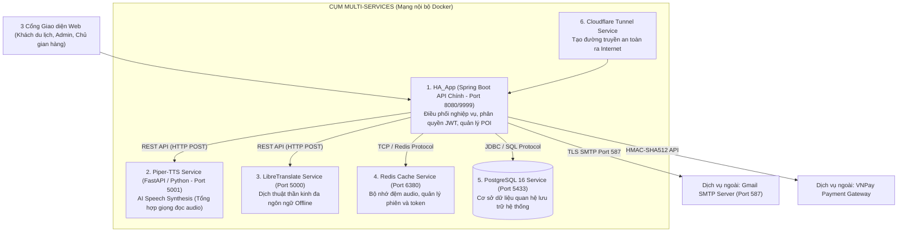
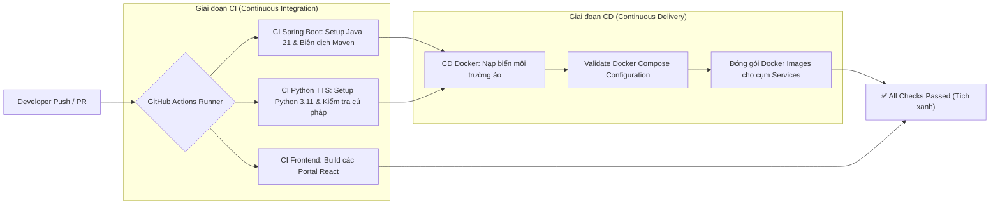

# HỘI AN HERITAGE - HỆ THỐNG THUYẾT MINH DU LỊCH TỰ ĐỘNG ĐA NGÔN NGỮ

[](https://github.com/QuangVinh-Dev/SoftwareEngineering-Project_SGU/actions/workflows/backend-services-ci-cd.yml)
[](https://github.com/QuangVinh-Dev/SoftwareEngineering-Project_SGU/actions/workflows/frontend-ci.yml)


> **Đồ án môn học**: Công nghệ phần mềm (Software Engineering Project - SGU)  
> **Giảng viên hướng dẫn**: Thầy Nguyễn Quốc Huy  
> **Phân công đề tài**: **Mục 3 - BE Dev: Tạo các services giao tiếp với nhau bao gồm CI/CD**  

---

##  THÀNH VIÊN NHÓM THỰC HIỆN

| STT | Họ và tên | GitHub Account | Email |
| :---: | :--- | :--- | :--- |
| 1 | **Võ Thị Thảo Vy** | [@VOTHITHAOVY](https://github.com/VOTHITHAOVY) | `vothithaovy06@gmail.com` |
| 2 | **Bùi Viết Quang Vinh** | [@QuangVinh-Dev](https://github.com/QuangVinh-Dev) | `buivietquangvinh@gmail.com` |
| 3 | **Nguyễn Như Thảo** | [@Nhuthaonguyen26](https://github.com/Nhuthaonguyen26) | `nguyennhuthao161@gmail.com` |

---

## 🏛️ TỔNG QUAN HỆ THỐNG (MỤC 3: MULTI-SERVICES & CI/CD)

Dự án áp dụng kiến trúc **Multi-Services (Nhiều dịch vụ độc lập)** được điều phối và đóng gói tự động bằng **Docker Compose**, phục vụ nền tảng thuyết minh di sản du lịch thông minh tại phố cổ Hội An:



### 1. Chi tiết các Services và cơ chế giao tiếp
1. **`ha-app` (Spring Boot 4.1.1 - Java 21)**:
   - Dịch vụ trung tâm (Core Service) điều phối toàn bộ luồng nghiệp vụ.
   - Quản lý xác thực phân quyền Spring Security & JWT Token.
   - Gọi HTTP REST sang Service `piper-tts` và `libretranslate` để xử lý audio và dịch thuật.
2. **`piper-tts` (Python 3.11 - FastAPI / Uvicorn)**:
   - Service AI chuyên biệt chạy trên cổng `5001`.
   - Nhận văn bản và tạo giọng đọc tự nhiên đa ngôn ngữ bằng mô hình ONNX Neural TTS chất lượng cao (`vi`, `en`, `ja`, `ko`, `zh`).
3. **`libretranslate`**:
   - Dịch vụ dịch máy học thần kinh (Machine Translation) chạy offline trên cổng `5000`.
   - Tự động chuyển ngữ nội dung giới thiệu điểm đến (POI) từ Tiếng Việt sang các thứ tiếng phục vụ khách quốc tế.
4. **`redis` (Redis 7 Alpine)**:
   - Hoạt động trên cổng `6380`.
   - Lưu trữ cache kết quả audio, trạng thái phiên thanh toán và tối ưu tốc độ phản hồi.
5. **`postgres` (PostgreSQL 16)**:
   - Hoạt động trên cổng `5433` (ánh xạ từ 5432).
   - Quản trị dữ liệu quan hệ với ràng buộc toàn vẹn, chỉ mục không gian toạ độ và bảo vệ giao dịch ACID.
6. **Dịch vụ tích hợp bên ngoài (External Services)**:
   - **VNPay Sandbox**: Cổng thanh toán trực tuyến mua gói dịch vụ nghe audio du lịch.
   - **Google Mail SMTP**: Tự động gửi email thông báo kết quả duyệt/từ chối hồ sơ kèm link đăng nhập cho chủ gian hàng.

---

##  QUY TRÌNH CI/CD TỰ ĐỘNG HÓA (GITHUB ACTIONS)

Toàn bộ mã nguồn được áp dụng quy trình **CI/CD** khép kín được cấu hình tại thư mục [`.github/workflows/`](./.github/workflows):



- **Quy trình CI Backend & Services (`backend-services-ci-cd.yml`)**:
  - Tự động kích hoạt khi có commit hoặc pull request vào các nhánh `main`, `feature`, `develop`.
  - Tự động build và biên dịch Java 21 với Maven Wrapper (`./mvnw clean compile`).
  - Tự động kiểm tra cú pháp Python cho Service `piper-tts`.
  - Kiểm tra tính tương thích của file `docker-compose.yml`.
  - Đóng gói Docker Images cho các services (`ha_app-app`, `ha_app-piper-tts`).
- **Quy trình CI Frontend (`frontend-ci.yml`)**:
  - Tự động kiểm tra cài đặt dependencies và chạy `npm run build` cho các giao diện React.

---

##  CÁC TÍNH NĂNG NỔI BẬT CỦA HỆ THỐNG

1. **Định vị Geofencing & Tự động phát thuyết minh**:
   - Khi du khách tiến vào bán kính quét (Radius) của điểm tham quan (POI), hệ thống tự động kích hoạt bài thuyết minh đúng vị trí toạ độ GPS.
2. **Hỗ trợ đa ngôn ngữ linh hoạt**:
   - Tự động chuyển ngữ và tạo audio giọng đọc theo 5 ngôn ngữ: Tiếng Việt, Tiếng Anh, Tiếng Nhật, Tiếng Hàn và Tiếng Trung.
3. **Hệ thống 3 Cổng tương tác chuyên nghiệp**:
   - **Cổng Khách du lịch (`HA.USER`)**: Bản đồ số di động, định vị người dùng, trình phát Audio Player nổi, thanh toán vé.
   - **Cổng Quản trị viên (`HA_ADMIN`)**: Duyệt hồ sơ gian hàng, phê duyệt nội dung POI, biểu đồ thống kê doanh thu và lượt nghe.
   - **Cổng Chủ gian hàng (`HA_Store Owner`)**: Thiết lập hồ sơ POI duy nhất (nhập GPS tự động hoặc toạ độ tay), theo dõi thống kê lượt nghe du khách theo thời gian thực.
4. **Hệ thống gửi Email thông báo tự động**:
   - Tự động gửi email giao diện HTML thương hiệu Hội An Heritage tới hộp thư chủ gian hàng khi Admin duyệt hoặc từ chối hồ sơ.

---

## 🛠️ HƯỚNG DẪN KHỞI CHẠY HỆ THỐNG (QUICK START)

### 1. Yêu cầu môi trường
- [Docker](https://www.docker.com/) & [Docker Compose](https://docs.docker.com/compose/)
- [Java 21 (JDK)](https://adoptium.net/) (nếu chạy local không dùng Docker)
- [Node.js 20+](https://nodejs.org/) & `npm`

### 2. Khởi chạy cụm Multi-Services bằng Docker Compose (Khuyên dùng)
Tại thư mục `HA_App`:
```bash
# 1. Di chuyển vào thư mục backend
cd HA_App

# 2. Khởi tạo cấu hình môi trường từ mẫu
cp .env.example .env

# 3. Khởi chạy toàn bộ cụm Services
docker compose up -d --build
```

Kiểm tra trạng thái các container đang chạy:
```bash
docker compose ps
```

### 3. Khởi chạy các giao diện Frontend
Mở từng thư mục frontend và chạy lệnh:
```bash
# Cổng Khách du lịch (Port 5173)
cd HA.USER/hoi-an-app && npm install && npm run dev

# Cổng Quản trị viên Admin (Port 5174)
cd HA_ADMIN && npm install && npm run dev

# Cổng Chủ gian hàng Store Owner (Port 5175)
cd "HA_Store Owner" && npm install && npm run dev
```

---

##  TÀI KHOẢN TRUY CẬP HỆ THỐNG

| Phân hệ | Đường dẫn truy cập | Tên đăng nhập | Mật khẩu mặc định |
| :--- | :--- | :--- | :--- |
| **Quản trị viên (Admin)** | `http://localhost:5174/login` | `admin` | `Admin@123` |
| **Chủ gian hàng (Store Owner)** | `http://localhost:5175/login` | `chugianhang` | `Mc-d9280d239f` *(hoặc `123456`)* |
| **Khách du lịch (User Web)** | `http://localhost:5173` | *(Truy cập trực tiếp không cần đăng nhập)* | — |

---

## 📂 CẤU TRÚC THƯ MỤC DỰ ÁN

```text
├── .github/
│   └── workflows/                # Cấu hình GitHub Actions CI/CD Pipeline
│       ├── backend-services-ci-cd.yml
│       └── frontend-ci.yml
├── HA_App/                       # Backend Spring Boot & Cụm Services Docker
│   ├── src/main/java/            # Mã nguồn Java 21 (Mô hình 3 lớp Controller - Service - Repository)
│   ├── tts-service/              # Microservice AI Text-To-Speech (FastAPI Python)
│   ├── docker-compose.yml        # Định nghĩa liên kết cụm Multi-services
│   └── Dockerfile                # Multi-stage build Dockerfile cho backend
├── HA_ADMIN/                     # Cổng thông tin Quản trị viên (React + TypeScript + Tailwind)
├── HA_Store Owner/               # Cổng thông tin Quản lý Gian hàng (React + TypeScript + Tailwind)
├── HA.USER/                      # Cổng ứng dụng Du khách di động (React + Leaflet Map)
└── Document/                     # Tài liệu đặc tả và báo cáo đồ án
```

---
*© 2026 - Đồ án Công nghệ phần mềm | Trường Đại học Sài Gòn (SGU)*
